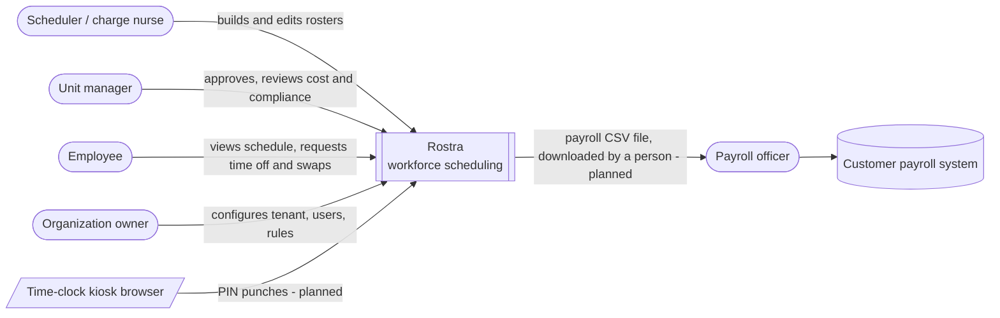
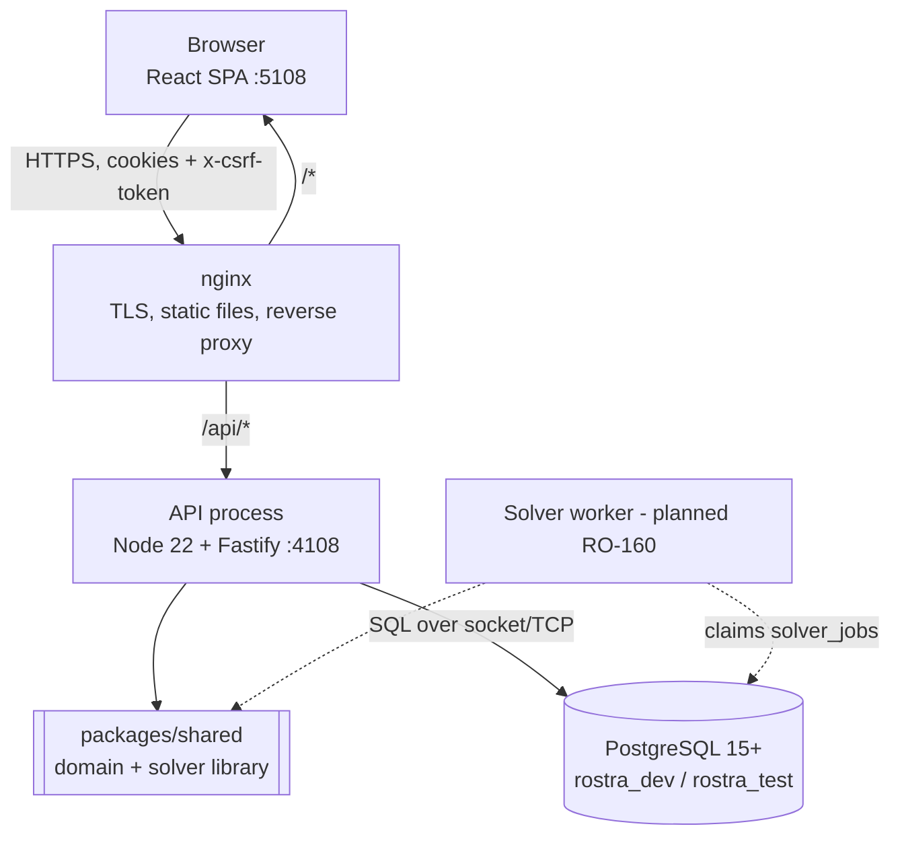
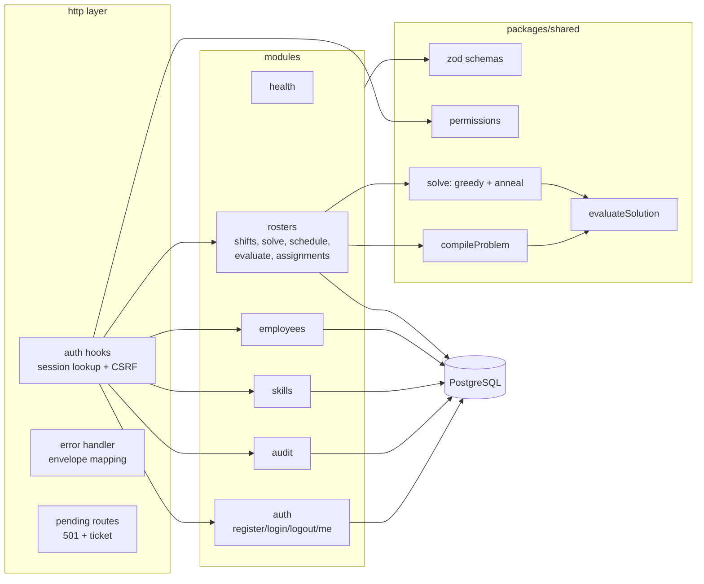
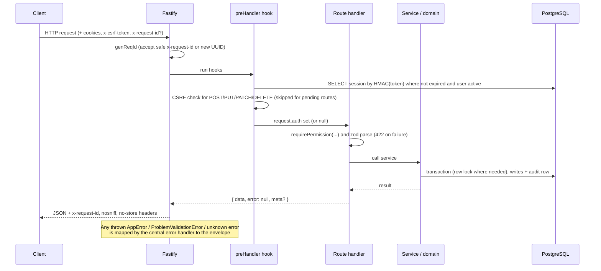

# Architecture overview

Rostra is a modular monolith in an npm-workspaces repository:

| Workspace         | Responsibility                                                                                              |
| ----------------- | ----------------------------------------------------------------------------------------------------------- |
| `packages/shared` | Pure domain: time-zone helpers, constraint model, rule evaluators, solver, zod schemas, RBAC table. No I/O. |
| `apps/api`        | Fastify 5 HTTP API, PostgreSQL access (`pg`), sessions, CSRF, audit, migrations, seed.                      |
| `apps/web`        | React 18 + Vite single-page app (week grid, employees, rosters).                                            |
| `e2e`             | Playwright smoke tests.                                                                                     |

The solver lives in `packages/shared` so the same evaluator can run in the API (solve,
evaluate, validate edits) and, later, in the browser for instant drag-and-drop feedback
(RO-172) without a network round trip.

## C4 level 1: system context

Rostra makes no outbound network calls. Email-like messages are written to an outbox
table (planned) and shown in-app; payroll leaves the system only as a downloaded CSV.

## C4 level 2: containers

In development Vite serves the SPA on port 5108 and proxies `/api` to the API on 4108.

## C4 level 3: API components

## Module boundaries

- **Domain package is pure.** It never imports from `apps/*`, never performs I/O and exposes
  immutable results. The single intentionally mutable structure, `SearchState`, is private to
  the solver ([ADR-0007](../adr/0007-incremental-search-state.md)).
- **Modules own their tables.** `employees` owns `employees`, `employee_skills`,
  `employee_unavailability`; `rosters` owns `rosters`, `shifts`, `assignments`, `solver_runs`.
  Cross-module reads go through exported repository functions (`listAllEmployees`,
  `resolveSkillIds`), not ad-hoc SQL.
- **Tenant scoping in repositories.** Every query takes `organizationId` from the session,
  never from the request body ([ADR-0004](../adr/0004-tenant-scoping-in-repositories.md)).
- **Pending features are registered routes.** `modules/pending/pending.routes.ts` lists every
  planned endpoint with its ticket, so the live surface equals `docs/api/openapi.yaml`.

## Request lifecycle

## Technology choices

| Concern          | Choice                                        | ADR                                                                                               |
| ---------------- | --------------------------------------------- | ------------------------------------------------------------------------------------------------- |
| Language/runtime | TypeScript strict, Node 22                    | [0001](../adr/0001-typescript-modular-monolith.md)                                                |
| HTTP             | Fastify 5 + @fastify/cookie                   | [0002](../adr/0002-fastify-and-plain-sql.md)                                                      |
| Data access      | `pg` with hand-written SQL                    | [0002](../adr/0002-fastify-and-plain-sql.md)                                                      |
| Auth             | Postgres sessions, scrypt, CSRF double submit | [0003](../adr/0003-session-auth-and-csrf.md)                                                      |
| Migrations       | In-repo forward-only runner                   | [0005](../adr/0005-forward-only-sql-migrations.md)                                                |
| Solver           | In-house greedy + simulated annealing         | [0008](../adr/0008-in-house-solver.md), [0009](../adr/0009-greedy-construction-plus-annealing.md) |
| Time             | UTC instants + Intl-only zone math            | [0012](../adr/0012-utc-instants-and-intl-time-zones.md)                                           |
