# Data model

PostgreSQL 15+. Conventions: `uuid` primary keys (`gen_random_uuid()`), `timestamptz` in UTC,
money in `bigint` minor units, every tenant-owned table reachable from `organization_id`.

## Migration status

| Migration                | Tables                                                                                  | Status                                   |
| ------------------------ | --------------------------------------------------------------------------------------- | ---------------------------------------- |
| `0001_foundation.sql`    | organizations, users, sessions, audit_log                                               | applied                                  |
| `0002_workforce.sql`     | skills, employees, employee_skills, employee_unavailability                             | applied                                  |
| `0003_rosters.sql`       | rosters, shifts, solver_runs, assignments                                               | applied                                  |
| `0004_org_structure.sql` | locations, departments, positions, user_department_scopes                               | planned (RO-110..RO-112)                 |
| `0005_contracts.sql`     | contracts (backfilled from employee columns)                                            | planned (RO-113)                         |
| `0006_identity.sql`      | invitations, password_resets, email_verifications, outbox_messages, rate_limit_counters | planned (RO-102, RO-104, RO-106, RO-107) |
| `0007_availability.sql`  | availability_patterns, time_off_requests                                                | planned (RO-130..RO-132)                 |
| `0008_demand.sql`        | historical_volumes, forecasts, forecast_points, coverage_requirements, shift_templates  | planned (RO-140..RO-151)                 |
| `0009_solver.sql`        | solver_jobs, labor_rule_sets, constraint_weight_sets                                    | planned (RO-160, RO-162, RO-165)         |
| `0010_publishing.sql`    | roster_versions, notifications                                                          | planned (RO-170..RO-173)                 |
| `0011_marketplace.sql`   | swap_requests, open_shift_claims                                                        | planned (RO-180..RO-183)                 |
| `0012_attendance.sql`    | kiosks, punches, timesheets, timesheet_lines                                            | planned (RO-190..RO-201)                 |
| `0013_payroll.sql`       | payroll_exports                                                                         | planned (RO-210)                         |

## Target ERD

```mermaid
erDiagram
  organizations ||--o{ users : has
  organizations ||--o{ sessions : scopes
  organizations ||--o{ audit_log : records
  organizations ||--o{ skills : defines
  organizations ||--o{ employees : employs
  organizations ||--o{ rosters : plans
  organizations ||--o{ locations : operates
  locations ||--o{ departments : contains
  departments ||--o{ positions : offers
  users ||--o{ sessions : opens
  employees ||--o{ employee_skills : holds
  skills ||--o{ employee_skills : granted
  employees ||--o{ employee_unavailability : blocks
  employees ||--o{ contracts : "versioned terms"
  employees ||--o{ availability_patterns : declares
  employees ||--o{ time_off_requests : requests
  rosters ||--o{ shifts : demands
  skills ||--o{ shifts : requires
  shifts ||--o{ assignments : filled_by
  employees ||--o{ assignments : works
  rosters ||--o{ solver_runs : history
  solver_runs ||--o{ assignments : produced
  rosters ||--o{ solver_jobs : queues
  rosters ||--o{ roster_versions : publishes
  locations ||--o{ rosters : schedules
  locations ||--o{ historical_volumes : measures
  locations ||--o{ coverage_requirements : needs
  forecasts ||--o{ forecast_points : contains
  locations ||--o{ shift_templates : patterns
  labor_rule_sets ||--o{ locations : governs
  users ||--o{ notifications : receives
  assignments ||--o{ swap_requests : offered
  kiosks ||--o{ punches : records
  employees ||--o{ punches : punches
  employees ||--o{ timesheets : submits
  timesheets ||--o{ timesheet_lines : itemizes
  payroll_exports ||--o{ timesheets : includes

  organizations { uuid id PK text name text timezone timestamptz created_at }
  users { uuid id PK uuid organization_id FK text email text role text password_hash bool is_active }
  sessions { text id PK "HMAC of token" uuid user_id FK text csrf_token inet ip timestamptz expires_at }
  audit_log { bigint id PK uuid organization_id FK uuid actor_user_id FK text action text entity_type jsonb details }
  skills { uuid id PK uuid organization_id FK text code text name }
  employees { uuid id PK uuid organization_id FK text name bigint hourly_rate_minor numeric min_hours_per_week numeric max_hours_per_week smallint max_consecutive_days numeric min_rest_hours int version }
  employee_skills { uuid employee_id PK uuid skill_id PK date expires_on }
  employee_unavailability { uuid id PK uuid employee_id FK tstzrange period text reason }
  rosters { uuid id PK uuid organization_id FK date week_start text timezone text status int version }
  shifts { uuid id PK uuid roster_id FK uuid skill_id FK text label timestamptz starts_at timestamptz ends_at smallint headcount }
  solver_runs { uuid id PK uuid roster_id FK bigint seed int iterations int hard_score int soft_score numeric coverage_ratio int elapsed_ms }
  assignments { uuid id PK uuid shift_id FK uuid employee_id FK bool pinned text source uuid solver_run_id FK }
  locations { uuid id PK uuid organization_id FK text name text timezone uuid labor_rule_set_id FK }
  departments { uuid id PK uuid location_id FK text name }
  positions { uuid id PK uuid department_id FK text name bigint default_rate_minor }
  contracts { uuid id PK uuid employee_id FK date effective_from numeric min_hours numeric max_hours jsonb rules }
  availability_patterns { uuid id PK uuid employee_id FK smallint weekday time start_local time end_local }
  time_off_requests { uuid id PK uuid employee_id FK tstzrange period text status uuid decided_by FK }
  historical_volumes { uuid id PK uuid location_id FK timestamptz interval_start numeric volume }
  forecasts { uuid id PK uuid location_id FK date week_start text method numeric mape }
  forecast_points { uuid forecast_id PK timestamptz interval_start PK numeric volume }
  coverage_requirements { uuid id PK uuid location_id FK uuid skill_id FK timestamptz interval_start smallint headcount }
  shift_templates { uuid id PK uuid location_id FK text code int start_minute int duration_minutes smallint headcount smallint[] days }
  solver_jobs { uuid id PK uuid roster_id FK text status int progress int roster_version jsonb result }
  labor_rule_sets { uuid id PK uuid organization_id FK text jurisdiction jsonb rules }
  roster_versions { uuid id PK uuid roster_id FK int version jsonb snapshot timestamptz published_at }
  notifications { uuid id PK uuid user_id FK text kind jsonb payload timestamptz read_at }
  swap_requests { uuid id PK uuid assignment_id FK uuid target_employee_id FK text status }
  kiosks { uuid id PK uuid location_id FK text name text device_token_hash }
  punches { uuid id PK uuid employee_id FK uuid kiosk_id FK text kind timestamptz at }
  timesheets { uuid id PK uuid employee_id FK date period_start text status }
  timesheet_lines { uuid id PK uuid timesheet_id FK text kind int minutes }
  payroll_exports { uuid id PK uuid organization_id FK date period_start text file_path text sha256 }
```

## Implemented tables

### organizations

Tenant root. `timezone` is the default zone for new rosters (canonical IANA name). Name 2-120 chars.

### users

One organization per user. `role` CHECK in (owner, admin, scheduler, manager, employee).
Unique index on `lower(email)` (global, so login needs no tenant hint). `is_active = false`
blocks session lookup.

### sessions

`id` is `HMAC-SHA256(SESSION_SECRET, cookie token)`; the raw token is never stored.
`csrf_token` binds the double-submit token to the session. Indexes on `user_id` and
`expires_at` (expired-session sweeper, RO-105).

### audit_log

Append-only trail: actor, action (`roster.solved`, `employee.updated`, ...), entity, request
id and JSON details (never secrets). Index `(organization_id, created_at DESC)` serves the
paged read endpoint.

### skills

`(organization_id, code)` unique; `code` matches `^[A-Z][A-Z0-9_]{1,31}$`.

### employees

Contract terms are columns for now (ADR-0015) with CHECKs: `max_hours_per_week >= min_hours_per_week`,
`max_consecutive_days` 1..7, `min_rest_hours` 0..24, `max_shifts_per_day` 1..3.
`preferred_days_off smallint[]` holds ISO weekdays. `version` increments per update.
`archived_at` reserved for RO-120. Partial index `(organization_id, name) WHERE archived_at IS NULL`.

### employee_skills

Composite PK `(employee_id, skill_id)`; `expires_on` is the last valid local date (null = no
expiry). `skill_id` is `ON DELETE RESTRICT` so a skill in use cannot vanish.

### employee_unavailability

`period tstzrange` (`[start, end)`), reason `time_off | unavailable`. GiST index on `period`
for overlap queries (time-off conflict preview, RO-132).

### rosters

One week (`week_start` date + `timezone`). `status` draft/published/archived; `version` bumped
on every change. Index `(organization_id, week_start DESC)`.

### shifts

UTC `starts_at`/`ends_at` with CHECK `ends_at > starts_at` and duration <= 16 h; `headcount` 1..50.
Index `(roster_id, starts_at)`.

### solver_runs

Seed, iterations, greedy vs final hard/soft scores, coverage, elapsed time and JSON stats
(accepted moves, improvements) for reproducibility and quality tracking.

### assignments

`UNIQUE (shift_id, employee_id)`; `pinned` survives re-solves; `source` solver/manual;
`solver_run_id` links solver output to its run. Index on `employee_id` (per-employee views).

## Planned table notes

- **contracts**: effective-dated; the solver picks the version effective on `week_start`.
- **solver_jobs**: queue claimed with `FOR UPDATE SKIP LOCKED`; stores `roster_version` to
  detect stale results.
- **rate_limit_counters**: `(key, window_start, count)` with upsert, replacing in-process
  limiters for multi-instance deployments (RO-107).
- **outbox_messages**: invitation, reset and verification messages shown in an admin outbox
  instead of being sent through a third-party provider.
- **punches**: server timestamp authoritative; `(employee_id, at)` index; duplicates within 60 s ignored.
- **payroll_exports**: file stored on local disk with SHA-256 for integrity.
