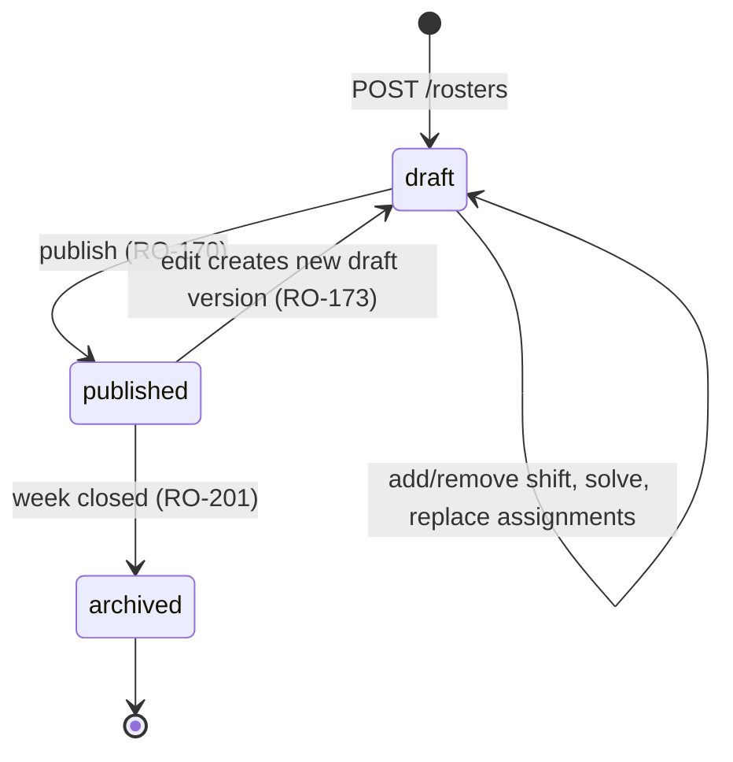
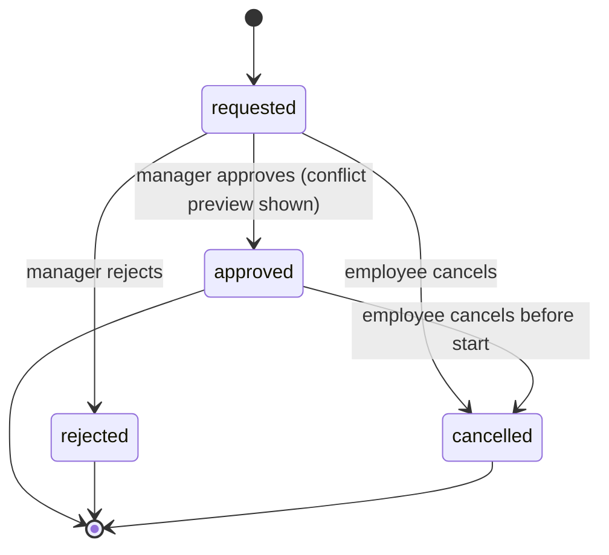
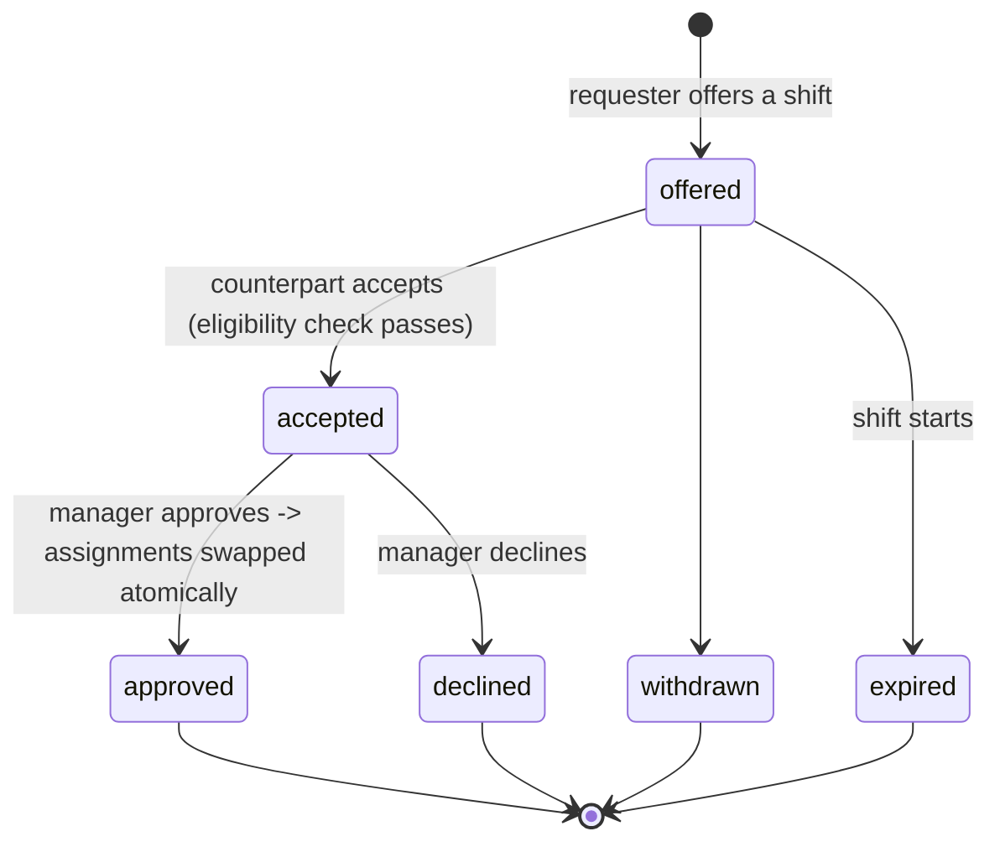

# System design

## 1. Scheduling model

A **roster** covers seven local days starting at `weekStart` in one IANA time zone. It owns
**shifts** (demand): a label, UTC start/end instants, a required skill and a headcount. Each
shift expands into `headcount` **slots**. A **solution** maps every slot to an employee index
or `-1` (unfilled). Employees carry a **contract** (hour limits, rest, consecutive days,
shifts per day, overtime threshold), **skill grants** (with optional expiry date),
**unavailability** periods and **preferences** (preferred ISO weekdays off, avoid nights).

`compileProblem(input)` validates and flattens this into arrays (`packages/shared/src/solver/problem.ts`):

| Derived field             | Computation                                                                                                      |
| ------------------------- | ---------------------------------------------------------------------------------------------------------------- |
| `shift.dayIndex`          | Days from `weekStart` to the local date of the shift start; must be 0..6                                         |
| `shift.isNight`           | Local start >= 20:00 or < 05:00                                                                                  |
| `shift.minutes`           | Real elapsed minutes (DST-aware because instants are UTC)                                                        |
| `staticReason[e*S+s]`     | `SKILL_MISSING`, `SKILL_EXPIRED` (grant expires before shift local date), `UNAVAILABLE` (any overlap), or `none` |
| `eligible[s]`             | Employees with `none` for shift `s`                                                                              |
| `slots[i].pinnedEmployee` | Employee fixed by a pinned assignment, else -1                                                                   |

### Rules

| Id                            | Severity | Penalty (default weight)                               |
| ----------------------------- | -------- | ------------------------------------------------------ |
| UNFILLED_SLOT                 | hard     | 10 per missing head                                    |
| SKILL_MISSING / SKILL_EXPIRED | hard     | 10 per assignment                                      |
| UNAVAILABLE                   | hard     | 10 per assignment                                      |
| OVERLAP                       | hard     | 10 per overlapping pair (incl. two heads of one shift) |
| MIN_REST                      | hard     | 2 x started hours of shortfall                         |
| MAX_HOURS                     | hard     | 2 x started hours over the weekly maximum              |
| MAX_CONSECUTIVE_DAYS          | hard     | 5 x days over the limit per run                        |
| MAX_SHIFTS_PER_DAY            | hard     | 10 x extra shifts per day                              |
| MIN_HOURS                     | soft     | 4 x started hours under the contracted minimum         |
| DAY_OFF_PREFERENCE            | soft     | 15 per preferred day worked                            |
| AVOID_NIGHTS                  | soft     | 10 per night shift for employees avoiding nights       |
| OVERTIME                      | soft     | 6 x started overtime hours                             |
| FAIRNESS                      | soft     | round(200 x variance of utilization)                   |

Score is `{hard, soft}`; search compares `hard * 1,000,000 + soft` (ADR-0011).

## 2. Algorithms and complexity

Notation: E employees, S shifts, N slots (sum of headcounts), k shifts per employee (~5), I iterations.

### 2.1 Compilation

Static eligibility is computed once: O(E * S * (g + u)) for g grants and u unavailability
periods per employee. For 160 x 160 this is ~25k checks, negligible.

### 2.2 Per-employee scoring (`scoreEmployee`)

Sort the employee's shifts by start (O(k log k)), then a single pass:

1. Static penalties per assignment (lookup in `staticReason`).
2. Overlap and rest: keep the shift with the latest end seen so far; `start < prevEnd` is an
   overlap, otherwise `start - prevEnd < minRest` is a rest shortfall. Using the latest end
   (not the immediately preceding shift) catches a short shift nested inside a long one.
3. Day buckets (7 counters): shifts per day; consecutive-day runs via a sweep to day 7.
4. Totals: minutes, max/min hours, overtime minutes, nights, preferred days off.

Cost O(k log k). Optional violation sink builds messages lazily (ADR-0013).

### 2.3 Full evaluation (`evaluateSolution`)

Group slots by employee O(N), score every employee O(E k log k), aggregate fairness O(E),
sort violations O(V log V). Used for API responses, manual edits and the final solver result.

### 2.4 Greedy construction (`constructGreedy`)

```
order = open, unpinned slots sorted by (|eligible[shift]| asc, start asc, index)
for slot in order:
    best = none; bestTotal = state.total()
    for e in shuffle(rng, eligible[shift]):
        state.assign(slot, e); t = state.total(); state.assign(slot, -1)
        if t < bestTotal: best, bestTotal = e, t
    if best: state.assign(slot, best)
```

Most-constrained-first reduces dead ends. Cost O(N * E * k log k); ~0.01 s for 544 slots.

### 2.5 Simulated annealing (`anneal`)

```
T(i) = T0 * (Tend / T0) ^ (i / I),  T0 = 40, Tend = 0.05
repeat I times:
    move = reassign (p = 0.6) | swap
    reassign: random movable slot; candidate = unassign (3%) | random eligible (89%) | random employee (8%)
    swap: two movable slots of different shifts with different employees exchange employees
    delta = total' - total
    accept if delta <= 0 or rand < exp(-delta / T); else undo
    track best snapshot
```

Each move rescores at most two employees via `SearchState` (ADR-0007): O(k log k) plus O(1)
fairness update; snapshots O(N) only on a new best. Total O(I * k log k + improvements * N).
Hard deltas are multiplied by 1e6, so `exp(-delta/T)` is 0 for hard-worsening moves.

### 2.6 Determinism

mulberry32 PRNG seeded per request; iteration budget, not time; stable orderings. Same input,
seed and budget produce deep-equal output (ADR-0010).

### 2.7 Time zones

`zonedToUtc(date, minuteOfDay, tz)` computes a naive UTC guess, corrects by the zone offset
twice, keeps candidates whose wall time round-trips, picks the earliest (fall-back ambiguity)
or, if none match (spring-forward gap), the later candidate (forward by the gap). Formatter
cache keyed by canonical zone names (ADR-0012).

### 2.8 Planned algorithms

| Ticket | Algorithm                                                                                                                  | Complexity target                     |
| ------ | -------------------------------------------------------------------------------------------------------------------------- | ------------------------------------- |
| RO-140 | Forecast = moving average x weekday/hour seasonal index, Holt smoothing option                                             | O(H) for H history points             |
| RO-143 | Shift generation from coverage: greedy interval covering with allowed shift lengths, then local trim of excess             | O(T * L) for T intervals, L templates |
| RO-161 | What-if: evaluate the roster with one extra assignment and diff violations                                                 | O(k log k)                            |
| RO-164 | Tabu list on (slot, employee), adaptive reheating when no improvement for X iterations, multi-start portfolio across seeds | linear in I                           |
| RO-163 | Carry-over: prepend last 7 days of the previous roster as pinned, non-scored context                                       | +O(k) per employee                    |

## 3. State machines

### Roster



Implemented: `draft` only; non-draft rosters reject changes with 409.

### Time-off request (planned, RO-131/RO-132)



Approved requests become `employee_unavailability` rows with reason `time_off`.

### Shift swap (planned, RO-180..RO-182)



## 4. Sequences

### Login

```mermaid
sequenceDiagram
  participant B as Browser
  participant A as API
  participant L as Limiters
  participant D as PostgreSQL
  B->>A: GET /api/v1/auth/csrf
  A-->>B: Set-Cookie rostra_csrf; {csrfToken}
  B->>A: POST /auth/login {email,password} + x-csrf-token
  A->>A: CSRF header == cookie
  A->>L: hit(ip+email), hit(ip), check email backoff
  alt over a limit
    A-->>B: 429 RATE_LIMITED + Retry-After
  end
  A->>D: SELECT user by lower(email)
  A->>A: scrypt verify (dummy hash if unknown user)
  alt invalid
    A->>L: record email failure
    A-->>B: 401 INVALID_CREDENTIALS
  else valid
    A->>L: reset ip+email and email counters
    A->>D: BEGIN; touch last_login; audit auth.login; INSERT session(HMAC(token)); COMMIT
    A-->>B: Set-Cookie rostra_session (HttpOnly), rostra_csrf; {csrfToken}
  end
```

### Solve

```mermaid
sequenceDiagram
  participant B as Browser
  participant A as API (rosters.service)
  participant D as PostgreSQL
  participant S as packages/shared solve()
  B->>A: POST /rosters/{id}/solve {seed, iterations, keepPinned}
  A->>A: requirePermission(rosters:solve); zod parse; cap iterations
  A->>D: BEGIN; SELECT roster ... FOR UPDATE
  A->>A: status must be draft (else 409)
  A->>D: load shifts, employees (+skills, unavailability), assignments
  A->>S: solve(problem with pinned, {seed, iterations})
  S->>S: compile -> greedy -> anneal -> evaluate best
  S-->>A: assignments, evaluation, stats
  A->>D: INSERT solver_runs; DELETE unpinned assignments; INSERT new (unnest); bump version; audit
  A->>D: COMMIT
  A->>D: read schedule view
  A-->>B: {run, schedule:{roster, shifts, employees, assignments, evaluation}}
```

## 5. Concurrency and consistency

- **Roster writes serialize** on `SELECT ... FOR UPDATE OF r` (solve, add/remove shift,
  replace assignments). Reads use MVCC snapshots and never block.
- **Atomic replacement**: assignment sets are deleted and re-inserted inside the same
  transaction as the solver run row and audit row; a failure rolls back all of it.
- **Integrity in the schema**: `UNIQUE (shift_id, employee_id)`, CHECKs on durations (<= 16 h),
  headcount, hour limits; `tstzrange` non-empty for unavailability.
- **Version counter** `rosters.version` increments on every change; RO-174 turns it into
  optimistic concurrency (`If-Match`) for the editing UI.
- **Planned asynchronous solving** (RO-160): `solver_jobs` claimed with
  `FOR UPDATE SKIP LOCKED`; the worker solves outside the lock, then re-acquires the roster
  lock and applies results only if `version` is unchanged, otherwise marks the job stale.
- **Rate limiter state** is per process (ADR-0006); shared counters (RO-107) are required
  before running multiple API instances.
