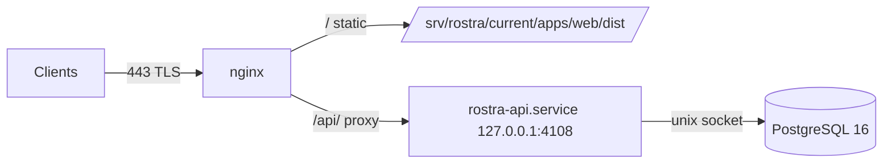

# Deployment

Target: a single Linux VM (Ubuntu 24.04 LTS) running Node.js 22, PostgreSQL 16+ installed from
the distribution packages, nginx as TLS terminator and static file server, and systemd. One API
process per database (rate-limit state is in-process until RO-107).

## Topology



## One-time host setup

```bash
sudo apt install -y nginx postgresql postgresql-contrib
curl -fsSL https://deb.nodesource.com/setup_22.x | sudo bash - && sudo apt install -y nodejs
sudo useradd --system --home /srv/rostra --shell /usr/sbin/nologin rostra
sudo -u postgres createuser rostra
sudo -u postgres createdb --owner=rostra rostra
sudo install -d -o rostra -g rostra /srv/rostra/releases /var/backups/rostra
sudo install -m 600 -o rostra /dev/null /etc/rostra.env
```

`/etc/rostra.env`:

```ini
NODE_ENV=production
API_HOST=127.0.0.1
API_PORT=4108
APP_ORIGIN=https://rostra.example.org
DATABASE_URL=postgresql:///rostra?host=/var/run/postgresql
SESSION_SECRET=<64 hex chars from: openssl rand -hex 32>
COOKIE_SECURE=true
TRUST_PROXY=127.0.0.1
LOG_LEVEL=info
SOLVER_MAX_ITERATIONS=200000
```

`TRUST_PROXY` must name nginx (loopback here); production refuses to start without it.

## systemd unit

`/etc/systemd/system/rostra-api.service`:

```ini
[Unit]
Description=Rostra API
After=network.target postgresql.service
Requires=postgresql.service

[Service]
User=rostra
WorkingDirectory=/srv/rostra/current/apps/api
EnvironmentFile=/etc/rostra.env
ExecStart=/usr/bin/node dist/index.js
Restart=on-failure
RestartSec=2
NoNewPrivileges=true
ProtectSystem=strict
ProtectHome=true
PrivateTmp=true

[Install]
WantedBy=multi-user.target
```

## nginx

```nginx
server {
  listen 443 ssl http2;
  server_name rostra.example.org;
  ssl_certificate     /etc/ssl/rostra/fullchain.pem;
  ssl_certificate_key /etc/ssl/rostra/privkey.pem;
  add_header Strict-Transport-Security "max-age=31536000" always;
  add_header Content-Security-Policy "default-src 'self'; frame-ancestors 'none'" always;

  root /srv/rostra/current/apps/web/dist;
  location / { try_files $uri /index.html; }

  location /api/ {
    proxy_pass http://127.0.0.1:4108;
    proxy_set_header X-Forwarded-For $remote_addr;   # overwrite, never append client values
    proxy_set_header X-Request-Id $request_id;
    proxy_read_timeout 60s;
    client_max_body_size 1m;
  }
}
```

## Release

```bash
REL=/srv/rostra/releases/$(date +%Y%m%d%H%M%S)
git clone --depth 1 --branch v0.1.0 https://github.com/mayur19/rostra.git "$REL"
cd "$REL" && npm ci && npm run build && npm prune --omit=dev
cd apps/api && sudo -u rostra env $(cat /etc/rostra.env | xargs) node dist/cli.js migrate
sudo ln -sfn "$REL" /srv/rostra/current
sudo systemctl restart rostra-api && curl -fsS http://127.0.0.1:4108/api/v1/ready
sudo systemctl reload nginx
```

Take a `pg_dump` immediately before migrating (see runbook).

## Rollback

- **Code only:** point `current` at the previous release and restart:
  `sudo ln -sfn /srv/rostra/releases/<previous> /srv/rostra/current && sudo systemctl restart rostra-api`.
- **With migrations:** migrations are forward-only. Prefer a forward fix; if the schema change
  must be undone, restore the pre-release dump into a new database, repoint `DATABASE_URL`, then
  roll back the code.

## Monitoring

`journalctl -u rostra-api` (JSON logs with request ids), nginx access logs, and a probe on
`/api/v1/ready`. Alert on repeated `rate limiter store full of active entries` warnings.
