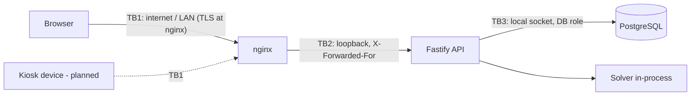

# Threat model

Scope: the API (`apps/api`), web client (`apps/web`), PostgreSQL and the host they run on, as
implemented in M0-M1, plus design notes for planned features. Method: data-flow diagram, trust
boundaries, STRIDE per element, mitigations mapped to OWASP ASVS 4.0.3.

## Assets

| Asset                                                                             | Why it matters                                                        |
| --------------------------------------------------------------------------------- | --------------------------------------------------------------------- |
| Credentials and session tokens                                                    | Account takeover gives control of rosters and staff data              |
| Employee personal data (names, emails, pay rates, availability, time off reasons) | Privacy; pay rates are commercially sensitive                         |
| Rosters and assignments                                                           | Wrong or tampered schedules leave wards understaffed (patient safety) |
| Audit log                                                                         | Accountability for who changed schedules                              |
| Solver capacity                                                                   | CPU-heavy; abuse can starve other tenants                             |

## Data flow and trust boundaries

- **TB1** untrusted clients to the reverse proxy.
- **TB2** proxy to API: the API trusts `X-Forwarded-For` only from proxies listed in
  `TRUST_PROXY`; `true` is rejected and production refuses to start when it is unset.
- **TB3** API to database with a least-privilege role; tenants are separated in the
  repository layer (every query filters `organization_id`).

## STRIDE

| #   | Threat                                  | Element           | Mitigation (implemented unless marked)                                                                                                                                                                                                            | ASVS             |
| --- | --------------------------------------- | ----------------- | ------------------------------------------------------------------------------------------------------------------------------------------------------------------------------------------------------------------------------------------------- | ---------------- |
| S1  | Credential stuffing / password spraying | Login             | Per-IP window, per IP+email window, per-source distinct-email cap, per-email progressive backoff backed by a non-evictable sketch (ADR-0006, ADR-0017)                                                                                            | V2.2.1           |
| S2  | Session hijacking via script            | Session cookie    | HttpOnly, SameSite=Lax, Secure in production; opaque 256-bit token, stored only as HMAC-SHA256                                                                                                                                                    | V3.4.1-3, V3.2.2 |
| S3  | Spoofed client IP to dodge throttles    | TB2               | `TRUST_PROXY` allow-list or hop count; IPv6 keyed by /64; IPv4-mapped IPv6 normalised                                                                                                                                                             | V11.1.4          |
| S4  | Account enumeration                     | Register/login    | Same 401 for unknown email and wrong password, dummy scrypt for unknown users; generic `REGISTRATION_FAILED`; registration throttled per IP. Residual: duplicate registration differs from success until email-verified sign-up (RO-106, planned) | V2.2.2           |
| T1  | Cross-site request forgery              | Mutating routes   | Double-submit token: header must equal cookie and the session's token                                                                                                                                                                             | V4.2.2           |
| T2  | Cross-tenant tampering (IDOR)           | All resources     | `organization_id` predicate in every repository query; uuid params validated; 404 for foreign ids (tests)                                                                                                                                         | V4.1.2, V4.2.1   |
| T3  | Concurrent overwrites of a roster       | Solve/edit        | Roster row `FOR UPDATE` lock serialises writes; version column with 409 (RO-174, planned)                                                                                                                                                         | V11.1.6          |
| T4  | SQL injection                           | Repositories      | Parameterised queries only; no string-built SQL from input                                                                                                                                                                                        | V5.3.4           |
| T5  | Malicious payloads                      | API boundary      | zod validation on every body/param/query; 1 MiB body limit; time zone canonicalised                                                                                                                                                               | V5.1.3           |
| R1  | Denying a schedule change               | Audit             | Append-only `audit_log` with actor, request id, entity; written in the same transaction                                                                                                                                                           | V7.1.3           |
| I1  | Secrets in logs                         | Logging           | pino redaction of cookies, CSRF header, set-cookie and passwords; error handler hides internals                                                                                                                                                   | V7.1.1, V7.4.1   |
| I2  | Data leakage in errors                  | Error handler     | Stable codes and messages; 500s logged server-side with request id only                                                                                                                                                                           | V7.4.1           |
| I3  | Over-broad reads by low roles           | RBAC              | Permissions per role (employee: rosters:read only); tests for 403                                                                                                                                                                                 | V4.1.3           |
| D1  | Solver CPU exhaustion                   | Solve             | Iteration cap (`SOLVER_MAX_ITERATIONS`), per-roster lock; async job queue with quotas (RO-160, planned)                                                                                                                                           | V11.1.4          |
| D2  | Memory exhaustion via throttle keys     | Limiters          | Bounded maps with amortised sweeping and hard caps; formatter cache keyed by canonical zone names                                                                                                                                                 | V11.1.4          |
| D3  | Lockout of a victim by an attacker      | Per-email backoff | Backoff capped at `LOGIN_EMAIL_BACKOFF_MAX_MS` (1 h); distinct-email cap per source                                                                                                                                                               | V2.2.1           |
| E1  | Privilege escalation via role change    | Users             | Only owner/admin roles will manage users (RO-103, planned); no role field accepted on register                                                                                                                                                    | V4.1.1           |

## Rate-limiter design trade-offs (fail open vs fail closed)

Bounded in-process memory forces a choice when it fills up. Evicting entries can lift an
attacker's lockout (fail open); refusing new keys lets an attacker block everyone (fail closed).
Rostra avoids both (ADR-0017): the precise per-key map always admits new keys and always wins
when it has an entry; an entry evicted while its lockout is still running is written to a
fixed-size count-min sketch, which is read only for keys without a precise entry. Ordinary
failures never touch the sketch, collisions can only over-throttle the keys sharing all four
buckets, and if a sketch row passes 50% occupancy the sketch is ignored (alerted) while the
other limiters continue. Remaining risks, accepted and tracked:

- Counters are per process and reset on restart. Running more than one API instance requires the
  shared PostgreSQL store (**RO-107**).
- An attacker controlling very many distinct sources can raise collision rates; the per-source
  distinct-email cap and per-IP window bound the rate.

## Planned feature notes

- **Kiosk punches (RO-190):** devices registered per location with a device secret; PINs hashed
  and throttled per device; server time only.
- **iCalendar feeds (RO-231):** signed, revocable URLs with no session; read-only.
- **Payroll exports (RO-210):** CSV formula injection prevented by prefixing cells that start
  with `= + - @`.
- **Outbox (RO-102, RO-104, RO-106):** tokens single-use, hashed at rest, short expiry.
